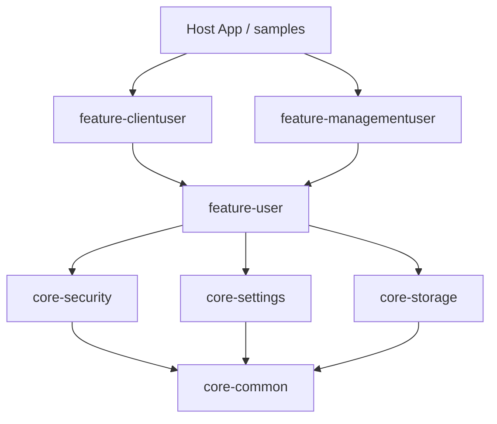

# SDK Clean Architecture & Layering Rules

The Web Platform SDK enforces strict Clean Architecture layer boundaries across all modules.

## Architecture Layers

1. **Domain Layer:** Entities, Value Objects, Repository Interfaces, Use Cases, Parsers.
2. **Infrastructure Layer:** REST API Fetch Clients, LocalStorage Caching, Encrypted Storage Adapters.
3. **Presentation Layer:** Zustand Reactive Stores, React Context Providers, Tailwind Components.

## Dependency Rules

- `core-common` has zero dependencies on higher-level packages.
- `feature-*` packages communicate via domain interfaces or host composition in `samples/*`.
- Features never import other `feature-*` packages directly except where composite features build upon base identity (`feature-user`).

