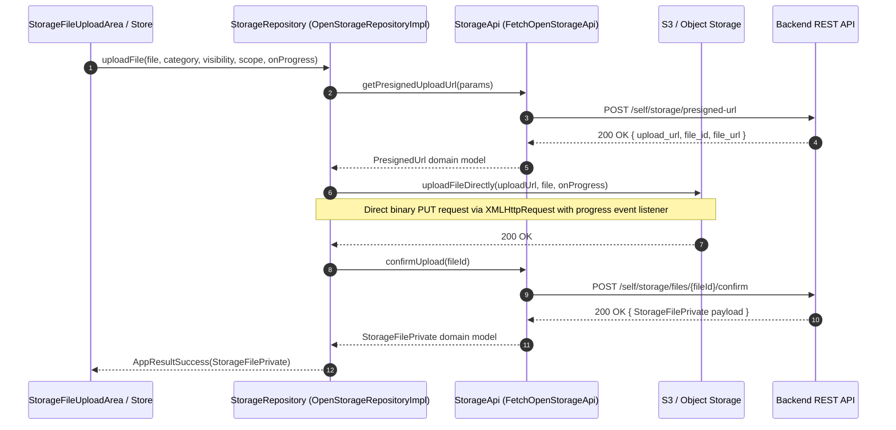
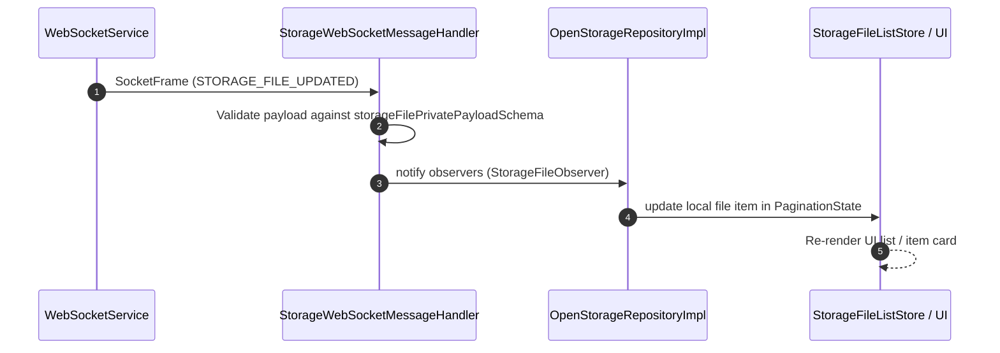
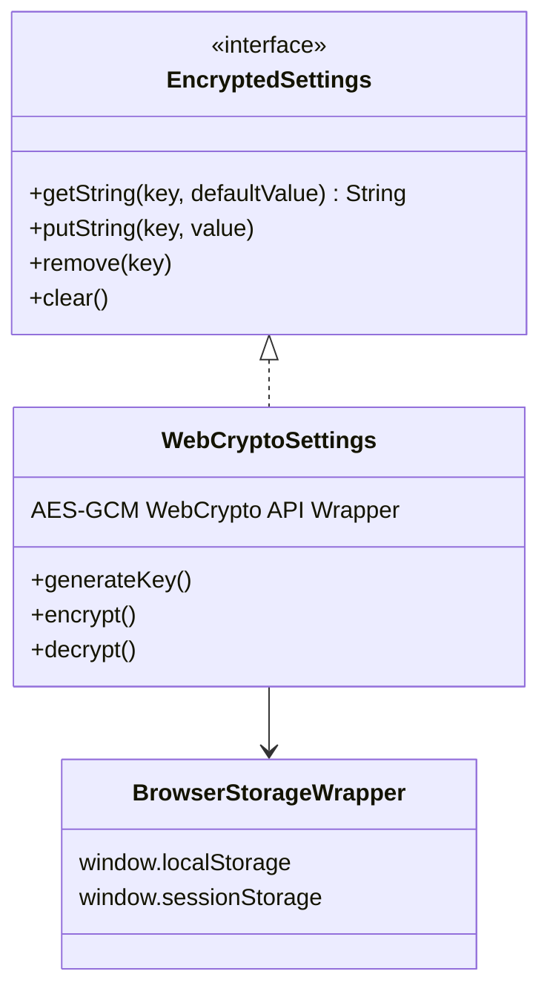
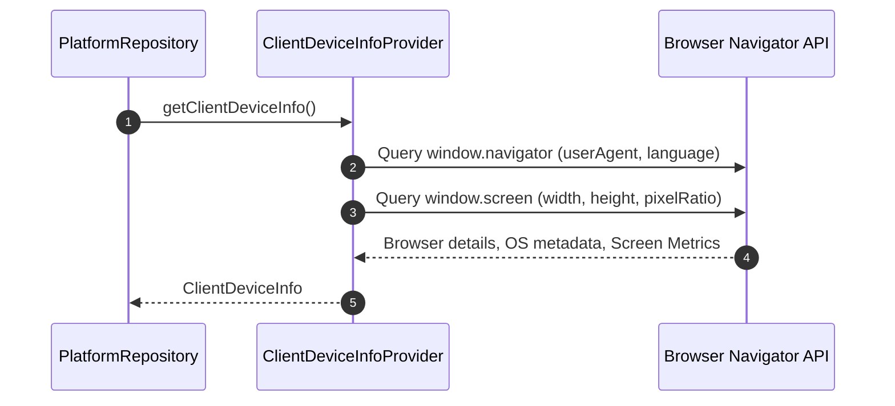

# File Storage, Encrypted Persistence & Platform Infrastructure Flow

This document details file storage operations, direct S3 presigned upload flows, target-specific encrypted storage abstractions (`EncryptedSettings`), browser platform metadata resolution, external system integration, and pagination infrastructure in `web-platform-sdk`.

---

## 1. File Storage & Direct S3 Presigned Upload Flow (`core-storage`)

File storage in `core-storage` leverages direct-to-S3 uploading via presigned URLs. This decouples binary file transfers from backend API servers and enables real-time progress callbacks.

### 1.1 Direct S3 Upload Sequence

### Key Components:
- **`StorageApi`**: Base API contract defined in `core-storage` for retrieving presigned URLs, confirming uploads, listing files, retrieving file details, and deleting files.
- **`uploadFileDirectly` (`DirectFileUploaderImpl`)**: Pure XMLHttpRequest implementation handling binary S3 upload streams without memory bloat, firing percentage progress callbacks (`0..100%`).
- **`StorageRepository`**: Central repository coordinating presigned URL acquisition, direct S3 streaming, upload confirmation, and WebSocket update observation.

---

## 2. File Storage WebSocket Real-Time Synchronization

When files transition states (e.g. `PENDING_UPLOAD` -> `PROCESSING` -> `READY` or `DELETED`), backend WebSocket events update reactive Zustand list stores in real-time.

---

## 3. Encrypted Local Storage Abstraction (`EncryptedSettings`)

The SDK mandates secure client persistence via `EncryptedSettings` (`core-common`), isolating domain logic from the physical storage API.

### Storage Backend
- **Web (`WebCryptoSettings`)**: Built on the native browser `window.crypto.subtle` API. It generates an AES-GCM symmetric key, encrypts all key-value entries into base64 ciphertexts, and persists them securely in `localStorage` or `sessionStorage`.

---

## 4. Platform Metadata Resolution (`ClientDeviceInfoProvider`)

`PlatformRepository` collects immutable browser hardware and environment metadata:

`ClientDeviceInfo` is automatically attached to HTTP headers and WebSocket initialization payloads to maintain accurate audit trails on the backend.

---

## 5. External System Interactions (`ExternalLauncher`)

Platform-native actions (opening external links, mail clients) are unified behind `ExternalLauncher`:
- **Web Implementation**: Utilizes `window.open(url, '_blank')` for URLs, and standard `window.location.href` for `mailto:` and `tel:` links.

---

## 6. Listing & Pagination Infrastructure

For infinite scrolling lists (files, sessions, identifiers, audit logs), the SDK provides standardized pagination building blocks in `core-common`:

- **State Container (`PaginationState`)**: Tracks cumulative list items, current page number, loading flags, error states, and intersection boundaries.
- **Scroll Monitoring (`useInfiniteScroll`)**: A React hook that registers an `IntersectionObserver` on an invisible marker element at the end of the list. Eliminates scroll event layout thrashing.
- **UI Footer (`PagingFooter`)**: Standard component added as the last item of lists to render `CoreButton` loading indicators or retry actions for failed pages.
