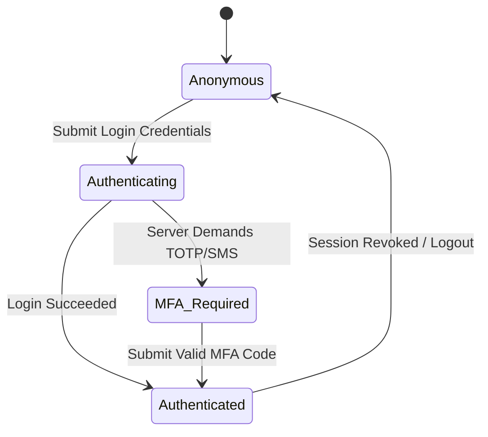

# Authentication & Multi-Factor Auth Flows

The Web Platform SDK handles complex state-machine authentication lifecycle steps automatically.

## Standard Auth State Machine



## Consuming Auth State via React Context Store Selector

```tsx
import React from 'react'
import { useClientUserStoreContext } from '@mudrichenkoevgeny/web-platform-sdk-feature-clientuser'

export const UserProfileBadge: React.FC = () => {
  const user = useClientUserStoreContext((state) => state.currentUser)

  if (!user) {
    return <span>Guest User</span>
  }

  return <span>{user.email}</span>
}
```
